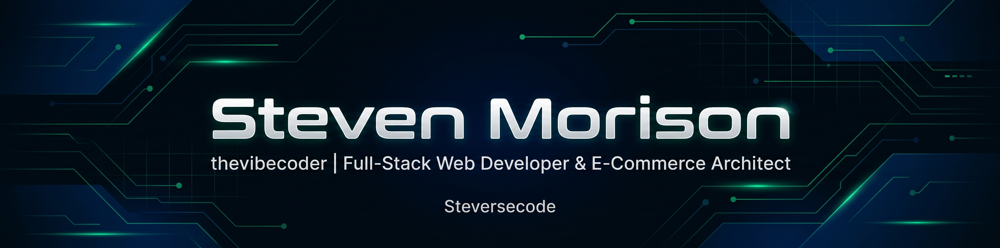

<div align="center">

  <!-- Header Banner -->
 <!-- Header Banner -->
  

  <br/>

  <!-- Typing Animation -->
 <!-- Typing Animation -->
  <a href="https://git.io/typing-svg">
    
  </a>

  <br/><br/>

  <!-- Quick Badges -->
  <p align="center">
    
    
    
  </p>

</div>

---

### 👨‍💻 About Me

### 👨‍💻 About Me

```yaml
Name:            "Steven Morison"
Alias:           "thevibecoder"
Github:          "steversecode"
Degree:          "S.Kom - Teknik Informatika (Informatics Engineering)"
Almamater:      "Universitas Teknologi Yogyakarta (UTY)"
Focus:           >-
                 Full-Stack Web Development, E-Commerce Systems,
                 API & Logistics Integrations, Application Security
Motto: "Vibe high, code clean, build things that solve real business problems."
```

- 🎓 **Lulusan Informatika** dari **Universitas Teknologi Yogyakarta (UTY)** dengan fokus pada rekayasa perangkat lunak web dan sistem informasi ritel modern.
- ⚡ Dikenal sebagai **thevibecoder** — antusias dalam mengubah konsep, desain estetis, dan *good vibes* menjadi aplikasi web berstandar produksi yang andal, aman, dan berkinerja tinggi.
- 🛍️ Berpengalaman membangun dan mengelola ekosistem **Omnichannel E-Commerce** skala penuh: integrasi *payment gateway* (Midtrans/QRIS), agregator ekspedisi logistik (*Biteship*), sistem *pre-order & wholesale/grosir*, serta otomatisasi follow-up WhatsApp.
- 🛡️ Memiliki perhatian mendalam terhadap **keamanan aplikasi web (Web Security)**: audit RBAC, mitigasi IDOR, pencegahan *price & shipping fee tampering*, anti-overselling via *database row-level locking*, dan enkripsi data pelanggan (PII protection).

---

### 🚀 Featured Production Projects

Berikut adalah beberapa platform e-commerce & web aplikasi berskala produksi yang saya kembangkan dan kelola:

<table>
  <tr>
    <td width="50%" valign="top">
      <h3 align="left">✨ <a href="https://manee.id" target="_blank">Maneé</a></h3>
      <p><b>URL:</b> <a href="https://manee.id">manee.id</a></p>
      <p><b>Deskripsi:</b> Platform e-commerce busana mewah (<i>high-fashion & luxury retail</i>) dengan fitur interactive WhatsApp chat room berkonteks produk otomatis, dynamic variant switching, diskon grosir berjenjang (B2B), pre-order limiter, serta integrasi Midtrans dan Biteship.</p>
      <p>
        
        
        
        
        
      </p>
    </td>
    <td width="50%" valign="top">
      <h3 align="left">👗 <a href="https://clabycla.id" target="_blank">Clabycla</a></h3>
      <p><b>URL:</b> <a href="https://clabycla.id">clabycla.id</a></p>
      <p><b>Deskripsi:</b> Storefront busana wanita kekinian dengan antarmuka belanja cepat, widget customer care cerdas, pelacakan pesanan publik terintegrasi resi kurir, serta sistem pengingat otomatis pembayaran via WhatsApp.</p>
      <p>
        
        
        
        
      </p>
    </td>
  </tr>
  <tr>
    <td width="50%" valign="top">
      <h3 align="left">🌸 <a href="https://biemi.id" target="_blank">Biemi</a></h3>
      <p><b>URL:</b> <a href="https://biemi.id">biemi.id</a></p>
      <p><b>Deskripsi:</b> Platform e-commerce ritel & grosir pakaian dengan dukungan flash sale berkala, alokasi stok multi-varian, integrasi multi-brand RBAC, dan analitik corong pengunjung (visitor funnel).</p>
      <p>
        
        
        
        
      </p>
    </td>
    <td width="50%" valign="top">
      <h3 align="left">🏢 <a href="https://mecsofficial.com" target="_blank">MECS Official</a></h3>
      <p><b>URL:</b> <a href="https://mecsofficial.com">mecsofficial.com</a></p>
      <p><b>Deskripsi:</b> Website resmi brand & katalog produk dengan fokus pada kecepatan performa, visual modern bernilai estetika tinggi, dan kemudahan pemesanan langsung bagi pelanggan setia.</p>
      <p>
        
        
        
      </p>
    </td>
  </tr>
</table>

---

### 💻 Tech Stack & Tools

<p align="left">
  <b>Backend & Core:</b><br/>
  
  
  
  
  
</p>

<p align="left">
  <b>Frontend & UI:</b><br/>
  
  
  
  
  
</p>

<p align="left">
  <b>Database, Queue & Cloud Infrastructure:</b><br/>
  
  
  
  
  
  
  
  
  
  
</p>

<p align="left">
  <b>Integrations & Third-Party Services:</b><br/>
  
  
  
  
  
</p>

---

### 📊 GitHub Activity & Statistics

<div align="center">
  <table border="0">
    <tr>
      <td>
        
      </td>
      <td>
        
      </td>
    </tr>
  </table>
  
  <br/>

  
</div>

---

### 📫 Let's Connect & Collaborate!

<p align="center">
  <a href="mailto:stevencodelab@gmail.com">
    
  </a>
  <a href="https://github.com/steversecode">
    
  </a>
</p>

<div align="center">
  <br/>
  
  <br/>
  <sub><i>Crafted with ❤️ and good vibes by <b>Steven Morison (@thevibecoder)</b>.</i></sub>
</div>
